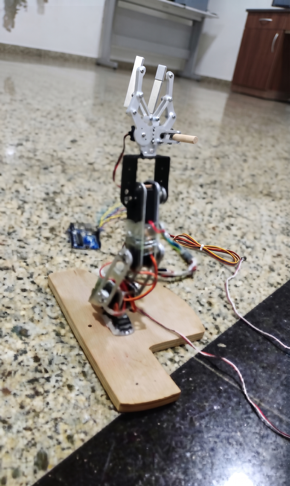

# 4-DOF Robotic Arm — Forward Kinematics

A Project for **Linear Algebra and Vector Geometry** modeling the forward kinematics of a **4-Degree-of-Freedom (4-DOF)** articulated robotic arm using homogeneous transformation matrices, the **Denavit–Hartenberg (D–H)** convention, and **MATLAB**.

## Hardware Prototype



## Overview

In robot kinematics, forward kinematics computes the position and orientation of the end-effector given known joint parameters and joint angles. Using the D–H representation, each joint frame is linked via a $4 \times 4$ transformation matrix $T_i$, and the overall end-effector transformation is obtained by chaining matrix multiplications:

$$T_t = T_1 T_2 T_3 T_4$$

The end-effector Cartesian position $(P_x, P_y, P_z)$ is read directly from the first three entries of the fourth column of $T_t$.

## Denavit–Hartenberg (D–H) Parameters

| Joint $i$ | Joint Type | $\alpha_i$ | $a_i$ | $d_i$ | $\theta_i$ |
| :---: | :--- | :---: | :---: | :---: | :---: |
| 1 | Base | $0^\circ$ | $0$ | $0$ | $\theta_1$ |
| 2 | Shoulder | $90^\circ$ | $0$ | $0$ | $\theta_2$ |
| 3 | Elbow | $0^\circ$ | $8$ | $0$ | $\theta_3$ |
| 4 | Wrist | $0^\circ$ | $8$ | $16$ | $\theta_4$ |

## Repository Structure

```text
4dof-robotic-arm-kinematics/
├── README.md                  # Project summary, D-H table, and usage guide
├── 4 DOF.docx             # Original report and analytical derivation
├── forward_kinematics.m   # MATLAB script computing T1..T4, Tt, and (Px, Py, Pz)
└── prototype_arm.jpg      # Physical 4-DOF arm prototype
```

## Usage

1. Open `matlab/forward_kinematics.m` in MATLAB.
2. Run the script and enter four joint angles in degrees when prompted, for example:
   ```matlab
   [0, 45, -30, 0]
   ```
3. Inspect the resulting homogeneous transformation matrix `Tt` and end-effector coordinates `(Px, Py, Pz)` in the Command Window.

## Authors

* Omar Shams El-santawi
* Moaaz El-Said
* Abanoub Selim
